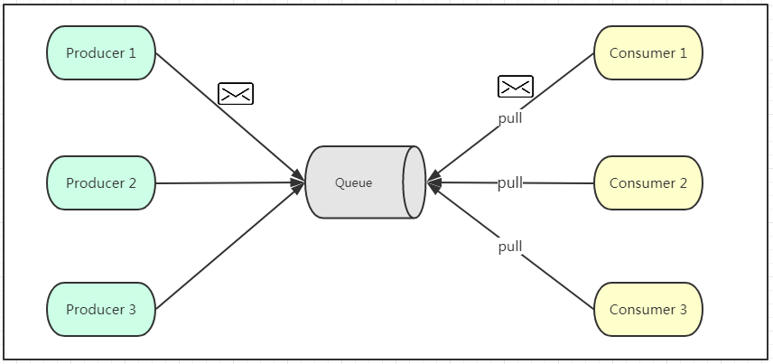
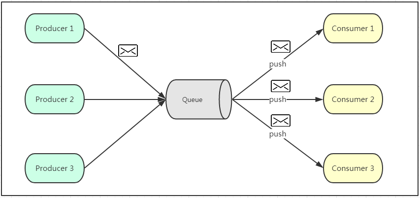
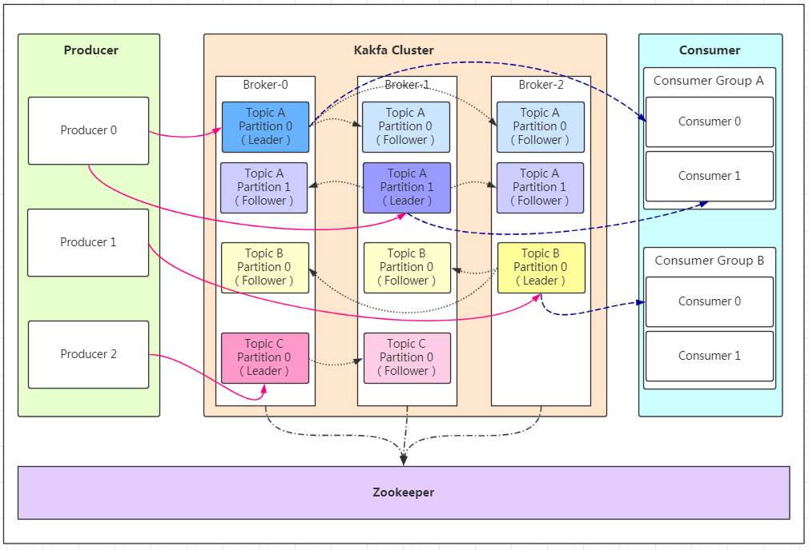

# Kafka

> create by nohi 20260116
>
> https://cloud.tencent.com/developer/article/2088077

## 一、概念

​		**Kafka**是最初由Linkedin公司开发，是一个分布式、支持分区的（partition）、多副本的（replica），基于zookeeper协调的[分布式消息系统](https://cloud.tencent.com/product/ckafka?from_column=20065&from=20065)，它的最大的特性就是可以实时的处理大量数据以满足各种需求场景，用scala语言编写，Linkedin于2010年贡献给了Apache基金会并成为顶级开源 项目。

### 1.特性

- **高吞吐量、低延迟**：kafka每秒可以处理几十万条消息，它的延迟最低只有几毫秒
- **可扩展性**：kafka集群支持热扩展
- **持久性、可靠性**：消息被持久化到本地磁盘，并且支持数据备份防止数据丢失
- **容错性**：允许集群中节点失败（若副本数量为n,则允许n-1个节点失败）
- **高并发**：支持数千个客户端同时读写

### 2.Kafka场景应用

- **日志收集**：一个公司可以用Kafka可以收集各种服务的log，通过kafka以统一接口服务的方式开放给各种consumer，例如hadoop、Hbase、Solr等。
- **消息系统**：解耦和生产者和消费者、缓存消息等。
- **用户活动跟踪**：Kafka经常被用来记录web用户或者app用户的各种活动，如浏览网页、搜索、点击等活动，这些活动信息被各个服务器发布到kafka的topic中，然后订阅者通过订阅这些topic来做实时的监控分析，或者装载到hadoop、[数据仓库](https://cloud.tencent.com/product/tchouse?from_column=20065&from=20065)中做离线分析和挖掘。
- **运营指标**：Kafka也经常用来记录运营监控数据。包括收集各种分布式应用的数据，生产各种操作的集中反馈，比如报警和报告。
- **流式处理**：比如spark streaming和storm
- **事件源**

### 3. Kafka一些重要设计思想

- **Consumergroup**：各个consumer可以组成一个组，每个消息**只能被组中的一个consumer消费**，如果一个消息可以被多个consumer消费的话，那么这些consumer必须在不同的组。

- **消息状态**：在Kafka中，消息的状态被保存在consumer中，broker不会关心哪个消息被消费了被谁消费了，只记录一个offset值（指向partition中下一个要被消费的消息位置），这就意味着如果consumer处理不好的话，broker上的一个消息可能会被消费多次。
- **消息持久化**：Kafka中会把消息持久化到本地文件系统中，并且保持极高的效率。
- **消息有效期**：Kafka会长久保留其中的消息，以便consumer可以多次消费，当然其中很多细节是可配置的。
- **批量发送**：Kafka支持以消息集合为单位进行批量发送，以提高push效率。
- **push-and-pull** :Kafka中的Producer和consumer采用的是push-and-pull模式，即Producer只管向broker push消息，consumer只管从broker pull消息，两者对消息的生产和消费是异步的。
- **Kafka集群中broker之间的关系**：不是主从关系，各个broker在集群中地位一样，我们可以随意的增加或删除任何一个broker节点。
- [**负载均衡**](https://cloud.tencent.com/product/clb?from_column=20065&from=20065)**方面**： Kafka提供了一个 metadata API来管理broker之间的负载（对Kafka0.8.x而言，对于0.7.x主要靠zookeeper来实现负载均衡）。
- **同步异步**：Producer采用异步push方式，极大提高Kafka系统的吞吐率（可以通过参数控制是采用同步还是异步方式）。
- **分区机制partition**：Kafka的broker端支持消息分区，Producer可以决定把消息发到哪个分区，在一个分区中消息的顺序就是Producer发送消息的顺序，一个主题中可以有多个分区，具体分区的数量是可配置的。分区的意义很重大，后面的内容会逐渐体现。
- **离线数据装载**：Kafka由于对可拓展的数据持久化的支持，它也非常适合向Hadoop或者数据仓库中进行数据装载。
- **插件支持**：现在不少活跃的社区已经开发出不少插件来拓展Kafka的功能，如用来配合Storm、Hadoop、flume相关的插件。


## 二、消息队列通信的模式

### 1.点对点模式



* 消息队列是否有消息需要消费，在消费者端无法感知，所以在消费者端需要额外的线程去监控。

### 2.发布订阅模式



* 生产者将消息放入消息队列后，队列会将消息推送给订阅过该类消息的消费者（类似微信公众号）。
* 由于是消费者被动接收推送，所以无需感知消息队列是否有待消费的消息！
* consumer1、consumer2、consumer3由于机器性能不一样，所以处理消息的能力也会不一样，但消息队列却无法感知消费者消费的速度！

## 三、Kafka的架构原理



- Producer：Producer即生产者，消息的产生者，是消息的入口。
- Broker：Broker是kafka实例，每个服务器上有一个或多个kafka的实例，我们姑且认为每个broker对应一台服务器。每个kafka集群内的broker都有一个不重复的编号，如图中的broker-0、broker-1等……
- Topic：消息的主题，可以理解为消息的分类，kafka的数据就保存在topic。在每个broker上都可以创建多个topic。
- Partition：Topic的分区，每个topic可以有多个分区，分区的作用是做负载，提高kafka的吞吐量。同一个topic在不同的分区的数据是不重复的，partition的表现形式就是一个一个的文件夹！
- Replication:每一个分区都有多个副本，副本的作用是做备胎。当主分区（Leader）故障的时候会选择一个备胎（Follower）上位，成为Leader。在kafka中默认副本的最大数量是10个，且副本的数量不能大于Broker的数量，follower和leader绝对是在不同的机器，同一机器对同一个分区也只可能存放一个副本（包括自己）。
- Message：每一条发送的消息主体。
- Consumer：消费者，即消息的消费方，是消息的出口。
- Consumer Group：我们可以将多个消费组组成一个消费者组，在kafka的设计中同一个分区的数据只能被消费者组中的某一个消费者消费。同一个消费者组的消费者可以消费同一个topic的不同分区的数据，这也是为了提高kafka的吞吐量！
- Zookeeper：kafka集群依赖zookeeper来保存集群的的元信息，来保证系统的可用性。


###  1.发送数据

####  a. 保证消息不丢失

保证消息不丢失是一个消息队列中间件的基本保证，过ACK应答机制！在生产者向队列写入数据的时候可以设置参数来确定是否确认kafka接收到数据，这个参数可设置的值为**0、1、all**。

- 0代表producer往集群发送数据不需要等到集群的返回，不确保消息发送成功。安全性最低但是效率最高。
- 1代表producer往集群发送数据只要leader应答就可以发送下一条，只确保leader发送成功。
- all代表producer往集群发送数据需要所有的follower都完成从leader的同步才会发送下一条，确保leader发送成功和所有的副本都完成备份。安全性最高，但是效率最低。

#### b.保存数据

Kafka初始会单独开辟一块磁盘空间，顺序写入数据（效率比随机写入高）。

* **Partition 结构**
  - 每个partition的文件夹下面会有多组segment文件
  - 每组segment文件又包含.index文件、.log文件、.timeindex文件（早期版本中没有）三个文件
  -  log文件就实际是存储message的地方，而index和timeindex文件为索引文件，用于检索消息。

* **Message结构**

  消息主要包含消息体、消息大小、offset、压缩类型……等等！

  - **offset**：offset是一个占8byte的有序id号，它可以唯一确定每条消息在parition内的位置！

  - **消息大小**：消息大小占用4byte，用于描述消息的大小。

  - **消息体**：消息体存放的是实际的消息数据（被压缩过），占用的空间根据具体的消息而不一样。

* **存储策略**

  * 基于时间，默认配置是168小时（7天）。
  * 基于大小，默认配置是1073741824。

* ##### 消费数据

  **建议消费者组的consumer的数量与partition的数量一致**！


## 四、部署

>  https://blog.csdn.net/qq_43544596/article/details/155242978

### 1. 单机部署

Apache Kafka 4.1.1 是一个高性能的分布式流处理平台，自 4.0 版本开始完全采用 KRaft 模式（不再依赖 ZooKeeper）。本文档详细介绍 Kafka 4.1.1 的两种部署模式：单机开发模式（适用于开发、测试环境）和集群生产模式（适用于高可用生产环境）。

*  server.properties

```properties
# server.properties
#基础参数
#当前节点唯一 ID
node.id=1
#节点角色：既是 controller 又是 broker
process.roles=broker,controller
#Controller 监听名
controller.listener.names=CONTROLLER
#Controller 集群成员（单机就是自己）
controller.quorum.voters=1@localhost:9093
#监听配置
#Kafka 对外监听（客户端连接用）
listeners=PLAINTEXT://0.0.0.0:9092,CONTROLLER://0.0.0.0:9093
#客户端访问时看到的地址
advertised.listeners=PLAINTEXT://localhost:9092
listener.security.protocol.map=CONTROLLER:PLAINTEXT,PLAINTEXT:PLAINTEXT
inter.broker.listener.name=PLAINTEXT
#数据与日志
#Kafka 数据目录
log.dirs=/data/kafka-logs
#Topic 默认配置
#默认分区数
num.partitions=1
#内部主题副本数（单机环境只能设为 1）
offsets.topic.replication.factor=1
transaction.state.log.replication.factor=1
transaction.state.log.min.isr=1
#日志管理
#日志保留时间（小时）
log.retention.hours=168
#单个 segment 大小：1GB
log.segment.bytes=1073741824
```

* #### 初始化与启动

  ```
  #生成集群 ID（只执行一次）
  cd /xxx/xxx/kafka
  ./bin/kafka-storage.sh random-uuid
  #示例输出后替换：Onw0IVI8RLyrb4djlCYHMg 
  #使用生成的 clusterId 格式化存储目录
  ./bin/kafka-storage.sh format -t Onw0IVI8RLyrb4djlCYHMg -c config/server.properties
  # 输出 data-logs目录为server.properties为配置文件中指定
  Formatting metadata directory /home/common/data/kafka_data/data-logs with metadata.version 4.1-IV1.
  
  #启动 Kafka 服务（前台运行，查看日志）
  ./bin/kafka-server-start.sh config/server.properties
  #或者后台启动
  ./bin/kafka-server-start.sh -daemon config/server.properties
  
  ```

* #### 验证单机服务

  ```
  #创建测试 Topic
  ./bin/kafka-topics.sh --create \
  --topic test-topic \
  --bootstrap-server localhost:9092 \
  --partitions 1 \
  --replication-factor 1
  
  #发送消息（生产者）
  ./bin/kafka-console-producer.sh \
  --topic test-topic \
  --bootstrap-server localhost:9092
  
  #接收消息（消费者）- 另开终端执行
  ./bin/kafka-console-consumer.sh \
  --topic test-topic \
  --bootstrap-server localhost:9092 \
  --from-beginning
  
  ./bin/kafka-console-consumer.sh \
  --topic test_topic \
  --bootstrap-server 10.0.0.210:9092 \
  --from-beginning
  ```

  

### 2. 集群

* 节点

  ```
  kafka-node1: 10.0.0.181 (node.id=1)
  kafka-node2: 10.0.0.182 (node.id=2)
  kafka-node3: 10.0.0.183 (node.id=3)
  
  # /etc/hosts 添加
  10.0.0.181 kafka-node1
  10.0.0.182 kafka-node2
  10.0.0.183 kafka-node3
  ```

* 环境准备

  ```
  mkdir -p /data/kafka/kafka-logs /data/kafka/kafka-meta
  chown -R nohi:nohi /data/kafka 
  ```

* 下载解压

  ```
  wget https://downloads.apache.org/kafka/4.1.1/kafka_2.13-4.1.1.tgz
  tar xzvf kafka_2.13-4.1.1.tgz
  ```

* 集群配置文件`server.properties`

  ```
  # 公用配置
  #KRaft 基本角色配置
  process.roles=broker,controller
  controller.listener.names=CONTROLLER
  controller.quorum.voters=1@kafka-node1:9093,2@kafka-node2:9093,3@kafka-node3:9093
  #监听配置
  listeners=PLAINTEXT://0.0.0.0:9092,CONTROLLER://0.0.0.0:9093
  listener.security.protocol.map=PLAINTEXT:PLAINTEXT,CONTROLLER:PLAINTEXT
  inter.broker.listener.name=PLAINTEXT
  #数据目录
  log.dirs=/data/kafka/kafka-logs
  metadata.log.dir=/data/kafka/kafka-meta
  #Topic 默认配置
  num.partitions=3
  log.retention.hours=168
  log.segment.bytes=1073741824
  #生产环境建议设置为 3
  offsets.topic.replication.factor=3
  transaction.state.log.replication.factor=3
  transaction.state.log.min.isr=2
  
  
  # 节点差异化配置，node.id=1/2/3 ip修改
  node.id=1
  advertised.listeners=PLAINTEXT://10.0.0.183:9092,CONTROLLER://10.0.0.183:9093
  ```

*  集群初始化

  ```
  # 在一个节点生成集群 ID（如 kafka-node1）
  bin/kafka-storage.sh random-uuid
  #示例输出：DxzTn-EpS-S7jbGt8pSKCw
  #所有节点执行格式化（使用相同的集群 ID）
  bin/kafka-storage.sh format \
  -t DxzTn-EpS-S7jbGt8pSKCw \
  -c config/server.properties
  ```

* 启动集群

  ```shell
  #每个节点执行
  cd /xxxx.xxx/kafka
  bin/kafka-server-start.sh -daemon config/server.properties
  #验证进程
  ps -ef | grep kafka
  netstat -lnpt | grep 9092
  netstat -lnpt | grep 9093
  ```

* 集群验证

  ```shell
  #创建测试 Topic（在任一节点执行）
  bin/kafka-topics.sh --create \
  --topic cluster-test \
  --bootstrap-server 10.0.0.181:9092 \
  --partitions 6 \
  --replication-factor 3
  
  #查看 Topic 分布情况
  bin/kafka-topics.sh --describe \
  --topic cluster-test \
  --bootstrap-server 10.0.0.182:9092
  
  #跨节点生产消费测试
  #在 kafka-node1 生产消息
  bin/kafka-console-producer.sh \
  --topic cluster-test \
  --bootstrap-server 10.0.0.181:9092
  
  #在 kafka-node2 消费消息
  bin/kafka-console-consumer.sh \
  --topic cluster-test \
  --from-beginning \
  --bootstrap-server 10.0.0.182:9092
  ```


## 五、Demo

### 1.Java 手工连接

> nohi-web: src/test/java/nohi/kafka/TestKafkaManualProducer.java / TestKafkaManualConsumer


## TODO

* 消息状态:如果consumer处理不好的话，broker上的一个消息可能会被消费多次。
  * 如何该上被消费多次？
  * 什么场景需要消费多次？